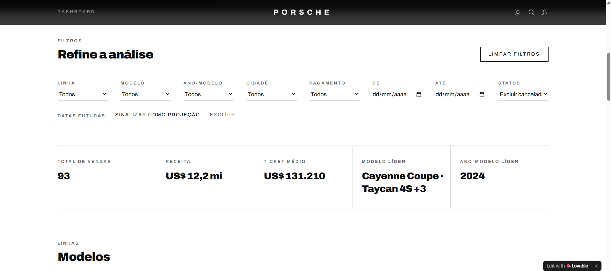
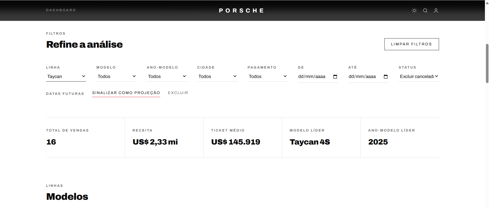

# Painel de Vendas Porsche: o que vende, onde e quando

Dashboard interativo que responde a perguntas de negócio sobre as vendas de uma rede de concessionárias Porsche: quais modelos vendem mais, em quais cidades e em que períodos. Os indicadores, os gráficos e a tabela mudam juntos quando você aplica os filtros.

> **Aviso:** é um painel de demonstração, não oficial, feito sem marcas ou imagens da Porsche AG. A base é de exemplo (100 vendas) e os valores estão em dólares americanos (US$), no formato brasileiro.

**Dashboard no ar:** [painel-vendas-porsche.lovable.app](https://painel-vendas-porsche.lovable.app/)

## Sobre o projeto

O desafio pedia uma dashboard em HTML que respondesse a perguntas de negócio sobre as vendas, com três perguntas escolhidas por mim, filtros, indicadores de topo, um visual coerente e um link próprio no ar. Em vez de montar um amontoado de gráficos, parti da pergunta: **o que vende, onde e quando**. Cada resposta tem um lugar claro no painel.

Usei como referência o [dashboard do professor](https://digitalinnovationone.github.io/dashboard_porsche_sales/). A seção [O que mudei em relação ao dashboard do professor](#o-que-mudei-em-relação-ao-dashboard-do-professor) detalha as diferenças.

### Como construí

<!-- PREENCHER: em 2 ou 3 linhas, conte como você construiu o painel na plataforma Lovable. Por exemplo, o que você pediu (a pergunta de negócio, a base, os filtros) e o que você ajustou depois. -->

## Como usar

1. Abra o [link do painel](https://painel-vendas-porsche.lovable.app/).
2. Role até a seção **Filtros** (ou clique em "Explorar vendas") e escolha o recorte: linha, modelo, ano-modelo, cidade, forma de pagamento, período, status e tratamento de datas futuras.
3. Veja os indicadores, os cards de modelos, os gráficos, a tabela por cidade e a leitura automática mudarem de acordo com o recorte.
4. Clique em "Limpar filtros" para voltar à visão geral.

## As três perguntas de negócio e onde aparece cada resposta

| # | Pergunta | Onde aparece | Resposta com os filtros padrão |
|---|---|---|---|
| 1 | **O que vende mais?** | Seção "Modelos" (um card por linha, com vendas e ticket médio), indicadores "Modelo líder" e "Ano-modelo líder" e gráfico "Vendas por ano-modelo" | A linha 911 lidera, com 22 vendas (24% do total). O modelo líder é um empate de cinco modelos com 4 vendas cada: Cayenne Coupe, Taycan 4S, Cayenne E-Hybrid, Macan Electric e Macan T. O ano-modelo líder é 2024 |
| 2 | **Onde vende mais?** | Seção "Desempenho regional" (tabela por cidade, com vendas, receita e modelo líder) | Atlanta lidera em vendas (3) e Las Vegas lidera em receita (US$ 473.500, com 2 vendas). As vendas são pulverizadas: 93 vendas em 73 cidades |
| 3 | **Quando vende?** | Seção "Evolução" (volume mensal e receita acumulada) | O gráfico mostra a evolução mês a mês, de 14/03/2024 a 01/10/2027. Barras claras indicam meses com vendas projetadas (datas futuras) |

## Indicadores de topo

Logo no início, três indicadores resumem o recorte:

| Indicador | Valor com os filtros padrão |
|---|---|
| Vendas | 93 |
| Receita | US$ 12,2 mi |
| Ticket médio | US$ 131.210 |

Depois dos filtros, o painel mostra o total de vendas, a receita e o ticket médio do recorte, mais o **modelo líder** e o **ano-modelo líder**. Quando há empate, o indicador mostra o primeiro modelo e a quantidade dos demais (por exemplo, "Cayenne Coupe · Taycan 4S +3").

## Filtros

| Filtro | Opções |
|---|---|
| Linha | 911, 718, Cayenne, Macan, Panamera e Taycan |
| Modelo | 40 modelos, de 718 Boxster a Taycan Turbo S |
| Ano-modelo | 2020 a 2026 |
| Cidade | Cidades da base |
| Pagamento | ACH Payment, Bank Transfer, Cash, Credit Card, Crypto Payment, Debit Card, Financing, Lease e Wire Transfer |
| Período (De e Até) | Intervalo de datas da venda |
| Status | Excluir canceladas (padrão), Todas, Somente entregues e Somente canceladas |
| Datas futuras | Sinalizar como projeção (padrão) ou Excluir |

## Regras de tratamento dos dados

- **Vendas canceladas:** das 100 vendas da base, 7 são canceladas e ficam de fora por padrão, por isso os indicadores mostram 93 vendas. O filtro "Status" permite incluí-las.
- **Datas futuras:** a base vai até 01/10/2027. As vendas com data posterior a 17/10/2026 (19 vendas) são tratadas como projeção e aparecem em barras claras no gráfico de evolução.
- **Classificação derivada:** a planilha não traz as colunas de linha e de motorização, então eu as criei. A **linha** é o prefixo do nome do modelo (911, 718, Cayenne, Macan, Panamera ou Taycan). A **motorização** segue estas regras: nomes com "E-Hybrid" são Híbrido, nomes com "Electric" ou da linha Taycan são Elétrico, e os demais são Gasolina.
- **Empates:** quando mais de um modelo lidera uma cidade ou o recorte, a tabela mostra todos e marca "empate".
- **Moeda:** valores em US$, formatados no padrão brasileiro (ponto para milhar e vírgula para decimais).

## Leitura automática

O painel gera textos de leitura a partir dos dados do recorte. Com os filtros padrão, eles dizem, por exemplo:

- a cidade de destaque (Atlanta, com 3 vendas);
- a linha mais popular (911, com 24% das vendas) e o modelo líder;
- a forma de pagamento preferida (Wire Transfer, com 28% das vendas);
- a cidade com o maior ticket médio (Arlington, US$ 286.500, com 1 venda);
- a pulverização das vendas (média de 1,3 venda por cidade);
- um alerta de amostra pequena (no máximo 3 vendas por cidade, então os rankings de cidade não são conclusivos);
- quantas vendas são projeção por terem data futura.

## Paleta e tipografia

<!-- PREENCHER: liste as cores (com os códigos hex) e as fontes que você escolheu, e onde cada uma aparece no painel. Se quiser, explique por que escolheu essa paleta. -->

| Elemento | Escolha |
|---|---|
| Cores principais | ... |
| Cor de destaque | ... |
| Fonte dos títulos | ... |
| Fonte do texto | ... |

## Estrutura do repositório

```
painel-vendas-porsche/
├── README.md
├── images/
│   ├── visao-geral.png
│   └── filtro-taycan.png
└── ... (código do projeto, exportado do Lovable)
```

## O que mudei em relação ao dashboard do professor

**O que mantive:** o foco em perguntas de negócio, os filtros por modelo, ano-modelo, cidade e forma de pagamento, os indicadores de topo (vendas, receita, modelo líder e ano-modelo líder) e uma leitura automática dos dados.

**O que mudei:**

- **Perguntas:** o dashboard do professor responde a "quais modelos vendem mais por cidade", "qual ano-modelo tem mais saída" e "vendas por estado". Organizei o meu em torno de **o que vende, onde e quando**: troquei a visão por estado por uma visão por cidade e acrescentei a evolução no tempo, com volume mensal e receita acumulada.
- **Idioma:** os rótulos estão todos em português (Ano-modelo, Cidade e Pagamento, no lugar de Model Year, City e Pay method).
- **Mais filtros:** além de modelo, ano-modelo, cidade e pagamento, acrescentei linha, período, status da venda e tratamento de datas futuras.
- **Indicadores:** acrescentei o ticket médio aos indicadores de topo.
- **Tratamento dos dados:** vendas canceladas saem por padrão e vendas com data futura são sinalizadas como projeção. No dashboard do professor, as datas inválidas aparecem como "Sem data".
- **Classificação derivada:** criei a linha e a motorização (Gasolina, Híbrido e Elétrico) a partir do nome do modelo.
- **Cuidado com a leitura:** o painel mostra os empates e avisa quando a amostra por cidade é pequena, para que os rankings não sejam lidos como conclusivos.

## Evidência de que funciona

<!-- PREENCHER: suba os prints para a pasta images/ com os nomes abaixo, ou ajuste os nomes dos arquivos. -->

Os dois prints mostram o mesmo painel, um sem filtro e outro com a linha Taycan selecionada:

| Visão geral (sem filtro) | Filtro: linha Taycan |
|---|---|
|  |  |

Os números esperados em cada recorte:

| Recorte | Vendas | Ticket médio |
|---|---|---|
| Visão geral | 93 | US$ 131.210 |
| Linha 911 | 22 | US$ 189.459 |
| Linha Taycan | 16 | US$ 145.919 |

## Limitações

- A base é pequena (100 vendas, com no máximo 3 por cidade nos dados filtrados). Os rankings por cidade são ilustrativos e não estatisticamente conclusivos, como o próprio painel avisa.
- A motorização é inferida pelo nome do modelo, porque a base não traz essa informação.
- Parte das vendas tem data futura (até 01/10/2027) e é tratada como projeção.
- Os valores estão em dólares, sem conversão para reais.
